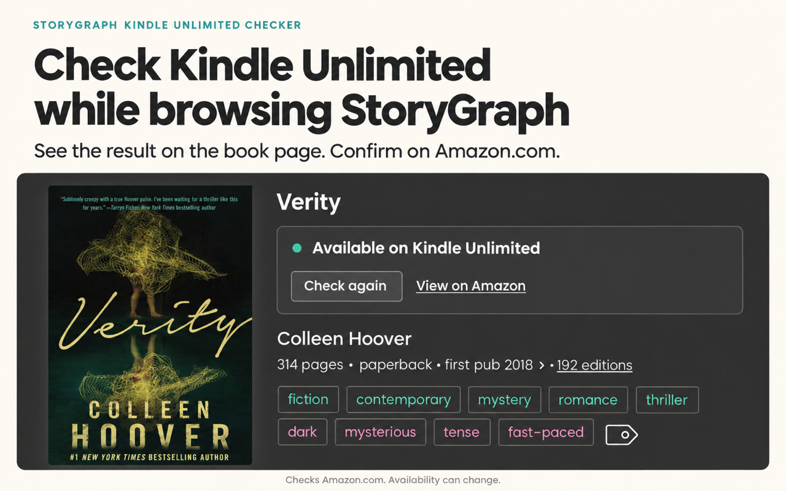

# StoryGraph Kindle Unlimited Checker

Check Kindle Unlimited availability while browsing books on StoryGraph.

[Install from the Chrome Web Store](https://chromewebstore.google.com/detail/storygraph-kindle-unlimit/emckkkkmblieobchogfjhipmijcfgfpn)



## How to use

1. Install the extension, then open a book page on [StoryGraph](https://app.thestorygraph.com).
2. Click **Check Kindle Unlimited** in the panel on the book page.
3. Review the result. Use **View on Amazon**, when available, to confirm the matching edition and offer.

There is no toolbar button or popup. If the book page was already open when you installed the extension, refresh it.

Returning to the same book within 24 hours shows the previous result. **Check again** always looks the book up on
Amazon again.

## What to expect

- Checks **Amazon.com** only. Other Amazon marketplaces are not supported.
- **Available on Kindle Unlimited** means the matching Amazon page showed a Kindle Unlimited offer when checked.
- **Kindle Unlimited was not detected** does not prove the book is unavailable. Confirm the edition and current offer
  on Amazon.
- A check may find no matching Kindle edition or time out. It can take up to about 45 seconds, and an incorrect edition
  can sometimes be selected.
- Checking opens Amazon in a background tab, which closes when a result arrives. A timeout can leave that tab open.

This project is not affiliated with, endorsed by, or sponsored by StoryGraph or Amazon.

## Privacy and support

No account is required. The extension has no analytics or advertising and sends no data to the developer. Running a
check sends book search terms (ISBN, or title and author) to Amazon.com. Check results are saved on your device; some
records remain until you uninstall the extension. Read the [privacy policy](PRIVACY.md) for details.

[Report an incorrect match, suggest a feature, or ask for help](https://github.com/klgh/storygraph-ku-check/issues).
For an incorrect match, include the StoryGraph book URL and the Amazon URL if available. Report security
vulnerabilities privately as described in [SECURITY.md](SECURITY.md).

## Local development

Requires Node.js and npm, and Chrome 130 or newer to run the extension.

1. Clone this repository and open its directory.
2. Install dependencies and build:

   ```sh
   npm install
   npm run build
   ```

3. Open `chrome://extensions`, enable **Developer mode**, and click **Load unpacked**.
4. Select the generated **dist/** directory.
5. Open or refresh a StoryGraph book page and use its Check panel.

`npm run dev` rebuilds on source changes. After a rebuild, reload the extension in `chrome://extensions` and refresh the
book page. Run `npm test` and `npm run typecheck` to check your changes.
